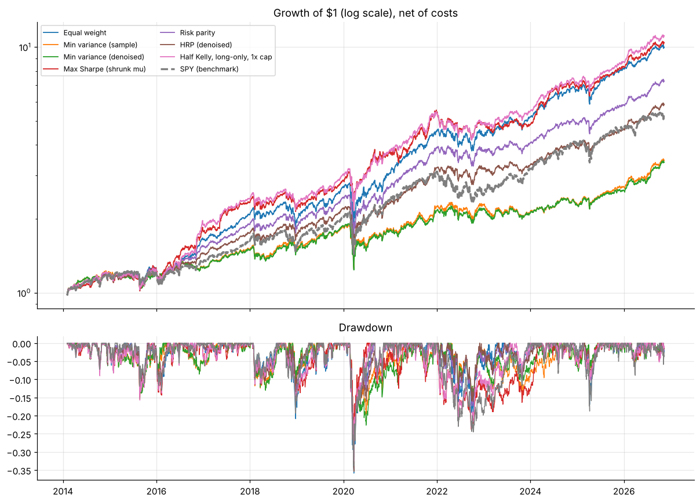
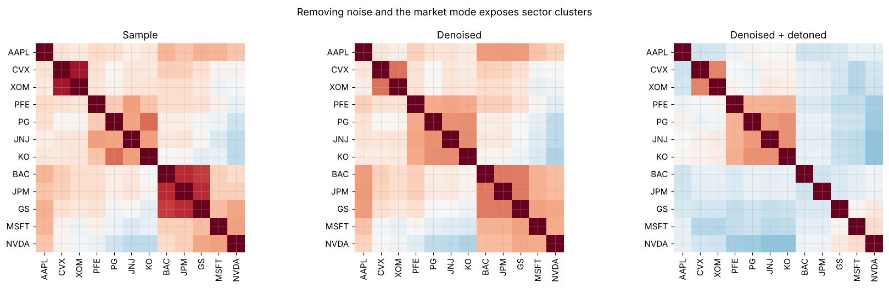
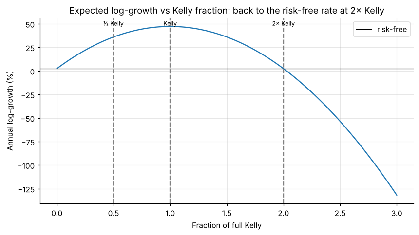

# Portfolio Optimization Lab

Portfolio construction methods implemented from scratch and compared in a **walk-forward backtest with transaction costs**. Covers Markowitz, Black-Litterman, Kelly sizing, risk parity, Hierarchical Risk Parity and random-matrix-theory covariance denoising.



## Methods

| Module | What it does |
|---|---|
| `covariance` | Sample and Ledoit-Wolf estimators; **Marcenko-Pastur denoising** (constant residual eigenvalue); detoning |
| `optimize` | Min-variance, max-Sharpe, target-return frontier, equal-risk-contribution (risk parity), **HRP** (Lopez de Prado 2016) |
| `black_litterman` | Reverse-optimised equilibrium returns, absolute and relative views, confidence-scaled view uncertainty |
| `kelly` | Multi-asset Kelly f* = Σ⁻¹(μ − r), fractional Kelly, gross-leverage caps, expected log-growth |
| `backtest` | Monthly walk-forward rebalancing, weight drift, cash/borrowing, costs on turnover; CAGR, Sharpe, Sortino, max drawdown, Calmar |

## Notebooks

| # | Notebook | Highlights |
|---|---|---|
| 1 | [Markowitz & Black-Litterman](notebooks/01_markowitz_and_black_litterman.ipynb) | Efficient frontier, estimation-error problem, BL with three investor views |
| 2 | [Denoising & HRP](notebooks/02_covariance_denoising_and_hrp.ipynb) | Marcenko-Pastur fit, denoised/detoned clustered correlations, HRP vs min-variance concentration |
| 3 | [Kelly & leverage](notebooks/03_kelly_criterion_and_leverage.ipynb) | Growth-vs-leverage curve, half Kelly, 10-year terminal-wealth Monte Carlo |
| 4 | [Walk-forward backtest](notebooks/04_walk_forward_backtest.ipynb) | 7 strategies vs SPY, net of 5 bp costs, 2014-2026 |
| 5 | [Utility, risk aversion & VaR](notebooks/05_utility_risk_aversion_and_var.ipynb) | Certainty equivalents, CARA vs CRRA, the optimal risky share, VaR vs ES (and why VaR fails subadditivity), and converting a VaR limit into an implied risk aversion |

<p float="left">
  
  
</p>

### Out-of-sample results (monthly rebalance, 2-year lookback, 5 bp costs)

| Strategy | CAGR | Vol | Sharpe | Max DD |
|---|---|---|---|---|
| Equal weight | 19.8% | 17.4% | 0.98 | −35.9% |
| Min variance (sample) | 10.2% | 14.5% | 0.57 | −33.6% |
| Min variance (denoised) | 10.1% | 14.6% | 0.56 | −35.1% |
| Max Sharpe (shrunk μ, 30% cap) | 20.2% | 17.8% | 0.98 | −29.3% |
| Risk parity | 16.8% | 16.0% | 0.90 | −34.8% |
| HRP (denoised) | 14.9% | 15.3% | 0.82 | −35.4% |
| Half Kelly, long-only, 1× cap | 20.8% | 17.6% | 1.02 | −32.6% |
| SPY (benchmark) | 13.9% | 17.2% | 0.70 | −33.7% |

*Universe: AAPL, MSFT, NVDA, JPM, BAC, GS, JNJ, PFE, XOM, CVX, PG, KO. One universe and one historical path: this demonstrates the framework and is not investment advice.*

## Quick start

```bash
git clone https://github.com/drimranbhatti/portfolio-optimization-lab.git
cd portfolio-optimization-lab
pip install -e ".[notebooks,dev]"
pytest                               # 9 tests
python scripts/fetch_prices.py       # optional: refresh data/prices.csv
jupyter lab notebooks/
```

```python
import pandas as pd
from portopt import covariance, optimize, backtest

rets = pd.read_csv("data/prices.csv", index_col=0, parse_dates=True).drop(columns="SPY").pct_change().dropna()
cov, n_signal, _ = covariance.denoise(covariance.sample(rets.iloc[-756:]), n_obs=756)
w = optimize.hrp(cov)

bt = backtest.walk_forward(rets, lambda h: optimize.hrp(covariance.ledoit_wolf(h)), lookback=504, cost_bps=5)
backtest.performance(bt["ret"])
```

## Validation
Tests check that unconstrained min-variance equals the closed-form solution; risk-parity contributions come out equal; HRP reduces to inverse-variance for a diagonal matrix; denoising keeps variances and positive-definiteness; Black-Litterman returns the prior when views agree with equilibrium; fractional Kelly scales linearly; and transaction costs reduce returns.

## References
Markowitz (1952) · Black & Litterman (1992) · He & Litterman (1999) · Kelly (1956) · Thorp (2006) · Maillard, Roncalli & Teiletche (2010) · Lopez de Prado (2016, 2020) · Ledoit & Wolf (2004) · Marcenko & Pastur (1967)

---
**Author:** Dr. Muhammad Imran Bhatti, PhD (Finance), MScFE · FCMA · [LinkedIn](https://www.linkedin.com/in/drimranbhatti) · [imranbhatti.com](https://imranbhatti.com)

*Built on my MScFE portfolio-management coursework (WorldQuant University) and rewritten as a standalone, tested library. MIT licensed.*
